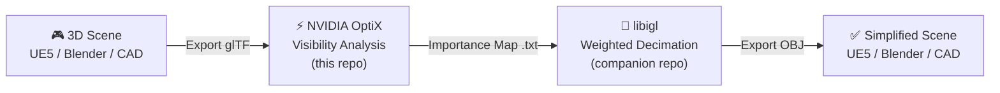

# Mesh Decimation via Weighted Importance Mapping — OptiX Module

**Undergraduate Thesis | Athens University of Economics and Business**  
Department of Informatics, School of Information Sciences & Technology  
C. Chrysafi · A. A. Manetas · Athens, 2025

---

> **This is the OptiX (visibility analysis) half of the pipeline.**  
> The companion simplification repository lives at [MeshDecimation-libigl](https://github.com/Heart-lex/MeshDecimation-libigl).

---

## Overview

Traditional mesh decimation treats all regions of a 3D model equally, often destroying visually important features while preserving unseen geometry. This project introduces a **visibility-driven importance mapping** approach that uses GPU-accelerated ray tracing to identify which parts of a mesh matter perceptually, then feeds that data into a weighted edge-collapse decimation algorithm.

This repository implements **Stage 1 and Stage 2** of the pipeline: ray-based visibility analysis using NVIDIA OptiX, producing a per-triangle importance map that drives the downstream simplification.

---

## Pipeline



| Stage | Tool | Input | Output |
|---|---|---|---|
| Data Preparation | UE5 / Blender | Scene | glTF + OBJ |
| **Visibility Analysis** | **OptiX (GPU)** | **glTF** | **Per-triangle weight .txt** |
| Importance Map | OptiX (CPU) | Raw hits | Normalized weight file |
| Weighted Simplification | libigl (CPU) | OBJ + weights | Simplified LOD meshes |

---

## What This Module Does

### 1. Ray Generation (`__raygen__rg`)

Rays are cast from a virtual camera or simulated agent across the scene. Each ray originates from a pixel on a virtual image plane with stochastic subpixel jitter to reduce aliasing:

```
for each pixel:
    ray = generate_ray(pixel_coords + rnd(seed))
    trace(ray, RadiancePRD)
```

### 2. Intersection Recording (`__closesthit__radiance`)

Only the **first** intersection per ray is recorded — mirroring how human occlusion works. Each hit is mapped to a global triangle index shared across all meshes in the scene:

```
global_triangle_id = primitive_id + geometry_offset
```

### 3. Perceptual Weight Computation

Each intersection accumulates a weight derived from two biologically inspired components:

**Distance Weighting** — logarithmic inverse-square falloff emphasising nearby geometry:

$$w_d = \frac{1}{\log_{10}(1 + d^2)}$$

**Foveated Weighting** — models the drop in human visual acuity from the foveal centre outward, using cosine similarity between the camera forward direction and the ray direction:

| Region | Angle | Weight |
|---|---|---|
| Foveal | ~5° | 1.0 |
| Parafoveal | ~20° | 0.51 – 0.99 |
| Peripheral | ~45° | 0.1 – 0.5 |

The final accumulated weight per hit:

$$w_i = \log(1 + w_d \cdot w_f)$$

### 4. Agent-Based Visibility Sampling (`__raygen__agent`)

A simulated agent traverses the scene autonomously, emulating realistic player movement or pre-recorded camera paths. At each step, four rays are cast in cardinal directions (0°, 90°, 180°, 270°). The agent moves toward the direction of longest unobstructed distance, turning away from blockages when a proximity threshold is met.

This bridges the gap between raw geometric sampling and perception-aware scene understanding — no real player data required.

### 5. Importance Map Export

After the ray-tracing pass, triangle weights are copied from GPU to CPU, standardized to stabilize the distribution, then normalized to `[0, 1]`:

- **1.0** → most frequently observed triangle
- **0.0** → never visible / fully occluded

The result is written as a plain `.txt` file (one value per line, one line per triangle) consumed directly by the libigl module.

---

## Results

The pipeline was evaluated on a custom apartment scene (112,591 triangles). The importance-weighted approach produced visually indistinguishable results from typical camera positions at significant polygon reductions:

| Reduction | Triangles Remaining | Visual Impact (from agent POV) |
|---|---|---|
| 0% (original) | 112,591 | Baseline |
| 50% | 56,261 | Negligible — major surfaces intact |
| 85% | 18,765 | Minimal — only silhouette edges affected |

NVIDIA FLIP comparisons confirmed that differences from the agent's point of view are confined to silhouette edges and minor geometric detail — imperceptible to the naked eye. Occluded geometry (e.g., lower body of a camel behind a wall) was aggressively simplified while visible regions were preserved.

> Full evaluation figures and NVIDIA FLIP difference maps are documented in the [thesis PDF](https://github.com/Heart-lex/MeshDecimation-OptiX).

---

## Requirements

### Hardware
- **NVIDIA RTX-capable GPU** with CUDA Compute Capability 5.0+ (OptiX requires hardware ray tracing support)

### Software
| Dependency | Version |
|---|---|
| NVIDIA OptiX SDK | 9.0.0 |
| CUDA Toolkit | 11.0+ |
| CMake | 3.10+ |
| C++ Compiler | C++17 compatible (MSVC 2019+, GCC 9+) |

### Scene Preparation
- Input scenes must be exported as **glTF 2.0** (`.gltf` + `.bin`)
- All geometry must be **manifold** (each edge shared by exactly two faces)
- All objects in the scene must be **joined into a single mesh** before export
- Non-manifold edges can be corrected with Blender's *3D Printing Toolkit*

> **Why glTF?** It is the only format supported by both NVIDIA OptiX (via the `sutil` helpers) and Unreal Engine 5 that preserves complete scene hierarchy, node transformations, and material properties in a GPU-friendly layout.

---

## Building

### Windows

Follow `SDK/INSTALL-WIN.txt` for the full setup. The short version:

```powershell
# Clone the repo
git clone https://github.com/Heart-lex/MeshDecimation-OptiX.git
cd MeshDecimation-OptiX

# Configure (point CMake to your OptiX install)
cmake -B build -S SDK `
      -DOptiX_INSTALL_DIR="C:/ProgramData/NVIDIA Corporation/OptiX SDK 9.0.0" `
      -DCMAKE_BUILD_TYPE=Release

# Build
cmake --build build --config Release
```

### Linux

Follow `SDK/INSTALL-LINUX.txt`. The process mirrors the Windows build with standard CMake:

```bash
cmake -B build -S SDK \
      -DOptiX_INSTALL_DIR=/path/to/optix \
      -DCMAKE_BUILD_TYPE=Release
cmake --build build -- -j$(nproc)
```

---

## Usage

After building, run the visibility analysis executable against your glTF scene:

```bash
# Basic usage
./MeshDecimation --scene path/to/scene.gltf --output weights.txt

# Configure ray count and agent steps (higher = more accurate, slower)
./MeshDecimation --scene path/to/scene.gltf \
                 --rays 1024 \
                 --agent-steps 500 \
                 --output weights.txt
```

The output `weights.txt` is consumed directly by the [libigl repository](https://github.com/Heart-lex/MeshDecimation-libigl) to perform weighted decimation.

---

## Limitations

| Constraint | Detail |
|---|---|
| **Manifold geometry required** | Non-manifold meshes cause incorrect intersection tests and must be repaired before processing |
| **Static scenes only** | Geometry and lighting must remain fixed during analysis; dynamic objects are not supported |
| **Offline pipeline** | Not optimized for real-time execution; an 85% decimation of ~120k triangles takes ~80 minutes on the simplification side |
| **Single-layer visibility** | Only the first ray intersection is recorded; translucency and secondary reflections are not modelled |
| **RTX GPU required** | NVIDIA OptiX requires CUDA-capable hardware with hardware ray tracing support |
| **File format** | Only glTF input is supported for OptiX; FBX/STL/PLY alter face indexing and break triangle–weight correspondence |

---

## Repository Structure

```
MeshDecimation-OptiX/
├── SDK/
│   ├── CMakeLists.txt          # Build configuration
│   ├── INSTALL-WIN.txt         # Windows setup guide
│   ├── INSTALL-LINUX.txt       # Linux setup guide
│   ├── cuda/
│   │   ├── camera.cu           # Ray generation programs
│   │   ├── geometry.cu         # Geometry intersection
│   │   ├── shading.cu          # Per-hit shading & weight accumulation
│   │   ├── whitted.cu          # Path tracing base (modified for visibility)
│   │   └── ...
│   ├── CMake/                  # FindOptiX, FindCUDA, compiler flags
│   └── data/                   # Sample scenes (Duck, ApartmentFloor, ...)
├── OptiX_EndUserLicense.pdf
└── README.md
```

---

## Related Work

This project builds on and extends the following:

- **Xanthopoulos (2021)** — *Evaluation of Illumination-Based Mesh Simplification* — the direct predecessor using lighting-driven importance via OptiX + libigl
- **Liu et al.** — *Seamless: Seam erasure and seam-aware decoupling of shape from mesh resolution* — seam-aware decimation extending the QSlim method
- **Lindstrom & Turk (2000)** — *Image-Driven Simplification* — multi-view image metric for visibility-aware simplification
- **Garland & Heckbert (1997)** — *Surface Simplification Using Quadric Error Metrics* — the foundational QSlim edge-collapse algorithm

---

## Authors

**C. Chrysafi** and **A. A. Manetas**  
Athens University of Economics and Business  
Department of Informatics · Athens, 2025

---

## License

This repository is based on the **NVIDIA OptiX SDK 9.0.0** sample framework. See [`OptiX_EndUserLicense.pdf`](OptiX_EndUserLicense.pdf) and [`OptiX_ThirdParty_Licenses.txt`](OptiX_ThirdParty_Licenses.txt) for terms covering the SDK components.

Custom pipeline code (visibility analysis, agent sampling, importance map export) is the work of the authors above.
